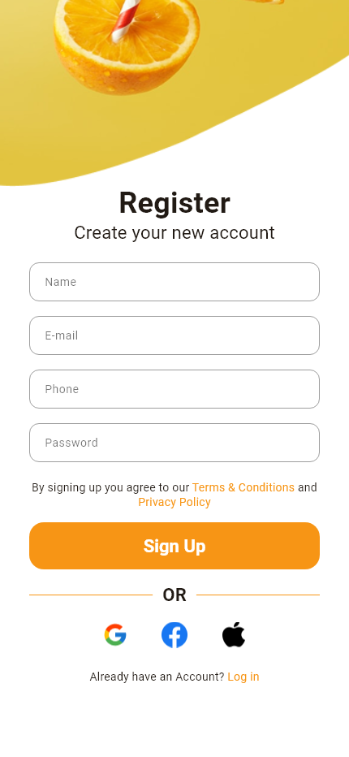
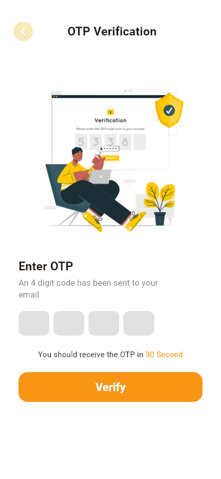

# flutter_workshop_ui_project

Assignment 02 ฝึกสร้าง UI 6 หน้าของแอป **Orange ส้ม** ด้วย Flutter และ Dart
ตาม Mockup สำหรับ iPhone 15 Pro Max ขนาด 430 × 932 logical pixels

## ภาพหน้าจอ

ภาพจากแอปเวอร์ชันสุดท้ายที่ขนาด 430 × 932 logical pixels

| Welcome / Berry Juice | Login | Register |
| :---: | :---: | :---: |
|  |  |  |

| Forgot Password | OTP Verification | Create New Password |
| :---: | :---: | :---: |
|  |  |  |

## ไฟล์หน้าจอ

| ไฟล์ใน `lib/views/` | Class | หน้าจอ |
|---|---|---|
| `e01_page_ui.dart` | `E01PageUI` | Welcome / Berry Juice |
| `e02_page_ui.dart` | `E02PageUI` | Login |
| `e03_page_ui.dart` | `E03PageUI` | Register |
| `e04_page_ui.dart` | `E04PageUI` | Forgot Password |
| `e05_page_ui.dart` | `E05PageUI` | OTP Verification |
| `e06_page_ui.dart` | `E06PageUI` | Create New Password |

เปิด Terminal ที่โฟลเดอร์โปรเจกต์ แล้วรัน

```sh
flutter pub get
flutter run -d chrome
```

ใช้ Device Toolbar ใน Chrome DevTools แล้วเลือก iPhone 15 Pro Max
หรือกำหนด viewport เป็น 430 × 932 เพื่อตรวจหน้าตาตามแบบ

รูปประกอบอยู่ใน `assets/images/` ส่วน `assets/icon/icon.png` เป็นรูปต้นทาง
สำหรับ launcher icon ที่ตั้งค่าไว้ใน `pubspec.yaml`
