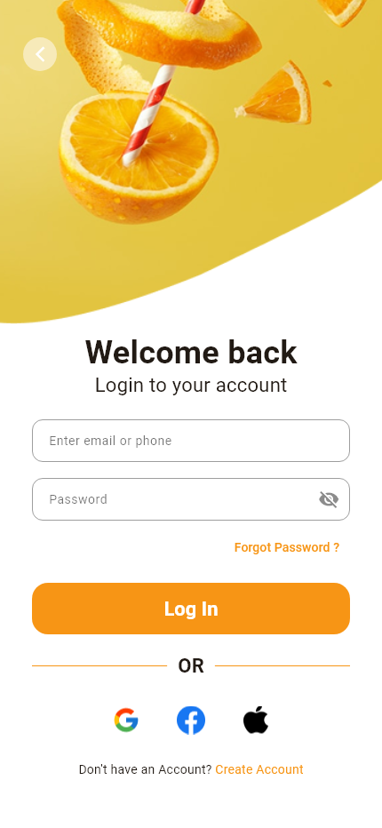

# Orange ส้ม

Orange ส้มเป็นต้นแบบหน้าจอมือถือ 6 หน้าสำหรับสาธิตการใช้งานแอป Berry Juice ตั้งแต่หน้าแนะนำไปจนถึงหน้าตั้งรหัสผ่านใหม่ พัฒนาด้วย Flutter และ Dart ใช้ธีม Material 3 และนำทางด้วย Flutter Navigator

## ฟังก์ชันการทำงาน

- หน้า Welcome แสดงข้อความ Berry Juice และปุ่ม Explore Now สำหรับไปหน้า Login
- หน้า Login และ Register แสดงฟอร์มกรอกข้อมูล พร้อมลิงก์สลับหน้าจอและไอคอน Google, Facebook และ Apple ตามแบบ UI
- ลิงก์ Forgot Password เปิดลำดับหน้ากรอกอีเมล กรอกรหัส OTP และตั้งรหัสผ่านใหม่ จากนั้นปุ่มยืนยันพากลับไปหน้า Login

## ภาพหน้าจอแอปพลิเคชัน

ภาพหน้าจอขนาด 430 × 932 logical pixels ตามขนาดอ้างอิง iPhone 15 Pro Max

| Welcome / Berry Juice | Login | Register |
| :---: | :---: | :---: |
|  |  |  |

| Forgot Password | OTP Verification | Create New Password |
| :---: | :---: | :---: |
|  |  |  |

## เทคโนโลยีที่ใช้

| เทคโนโลยีหรือแพ็กเกจ | หน้าที่ |
| --- | --- |
| Flutter, Dart และ Material 3 | สร้างหน้าจอ จัดธีม และนำทางระหว่างหน้าจอ |
| `material_ui` | Material widgets สำหรับหน้าจอและฟอร์ม |
| `google_fonts`, `cupertino_icons` | แพ็กเกจที่ประกาศใน `pubspec.yaml` โดยหน้าจอใช้ฟอนต์จากธีม Flutter และไอคอนตามแบบ |
| `flutter_test`, `flutter_lints` | Widget Test และกฎวิเคราะห์โค้ด |
| `flutter_launcher_icons` | กำหนด Launcher Icon สำหรับ Android และ iOS |

## โครงสร้างโปรเจกต์

| ไฟล์ | Class | หน้าที่ |
| --- | --- | --- |
| `lib/main.dart` | `MyApp` | ตั้งธีมและจำกัดความกว้าง UI ที่ 430 logical pixels |
| `lib/views/e01_page_ui.dart` | `E01PageUI` | หน้าแนะนำ Berry Juice |
| `lib/views/e02_page_ui.dart` | `E02PageUI` | หน้าเข้าสู่ระบบ |
| `lib/views/e03_page_ui.dart` | `E03PageUI` | หน้าสมัครบัญชี |
| `lib/views/e04_page_ui.dart` | `E04PageUI` | หน้ารับอีเมลเพื่อกู้รหัสผ่าน |
| `lib/views/e05_page_ui.dart` | `E05PageUI` | หน้ากรอก OTP |
| `lib/views/e06_page_ui.dart` | `E06PageUI` | หน้าตั้งรหัสผ่านใหม่ |
| `lib/views/orange_header.dart` | `OrangeHeader`, `OrangeBackButton` | ส่วนหัวและปุ่มย้อนกลับที่ใช้ร่วมกัน |
| `assets/images/`, `assets/icon/icon.png` | — | ภาพประกอบและภาพต้นทางของ Launcher Icon |

## การติดตั้งและใช้งาน

ใช้ Flutter SDK 3.47.0 ขึ้นไปตาม `pubspec.lock` ที่รองรับ Dart `^3.14.0` ตาม `pubspec.yaml` ติดตั้ง Chrome แล้วรันคำสั่งจากโฟลเดอร์โปรเจกต์

```sh
flutter pub get
flutter run -d chrome
```

ใน Chrome DevTools เปิด Device Toolbar แล้วเลือก iPhone 15 Pro Max หรือกำหนด viewport เป็น 430 × 932 เพื่อดู UI ตามขนาดของ Mockup

## การทดสอบและข้อจำกัด

- บันทึกการทดสอบ UI ระบุว่าตรวจการแสดงผลและการนำทางครบ 6 หน้าที่ขนาด 430 × 932 รวมถึงพื้นที่ฟอร์ม 5 หน้าเมื่อเปิดแป้นพิมพ์ บันทึกไม่ได้ระบุ Git commit ที่ใช้ทดสอบ
- มี [Widget Test](test/widget_test.dart) สำหรับข้อความ BERRY JUICE และปุ่ม Explore Now ผลการรันยังไม่ได้ยืนยัน
- ผล `flutter analyze` ผล Build และผลทดสอบแยกตามแพลตฟอร์มหรือบนอุปกรณ์จริงยังไม่ได้ยืนยัน
- ฟอร์ม Login, Register, OTP และตั้งรหัสผ่านเป็นขั้นตอนสาธิต แอปยังไม่มี Backend สำหรับยืนยันตัวตน ส่ง OTP หรือบันทึกรหัสผ่าน

## เครดิตและสิทธิ์การใช้งาน

### ทรัพยากรจากอาจารย์และ Figma

การออกแบบ UI และทรัพยากรประกอบแอปอ้างอิงจาก Figma และชุด Resources ที่อาจารย์จัดเตรียมให้สำหรับรายวิชาการพัฒนาโปรแกรมประยุกต์สำหรับอุปกรณ์เคลื่อนที่

### ฟอนต์ แพ็กเกจ และสัญญาอนุญาตโอเพนซอร์ส

UI ใช้ตัวอักษรจากธีม Flutter และไม่พบไฟล์ฟอนต์ที่เก็บเป็น Asset ของโปรเจกต์ ตารางนี้อ้างอิงเวอร์ชันแพ็กเกจจาก `pubspec.lock`

| แพ็กเกจ | ผู้ถือลิขสิทธิ์ | สัญญาอนุญาต |
| --- | --- | --- |
| `material_ui` 1.11.1 | The Flutter Authors | [BSD-3-Clause](https://pub.dev/packages/material_ui/versions/1.11.1/license) |
| `google_fonts` 9.0.0 | The Flutter Authors | [BSD-3-Clause](https://pub.dev/packages/google_fonts/versions/9.0.0/license) |
| `cupertino_icons` 1.0.9 | Vladimir Kharlampidi | [MIT](https://pub.dev/packages/cupertino_icons/versions/1.0.9/license) |
| `flutter_lints` 6.0.0 | The Flutter Authors | [BSD-3-Clause](https://pub.dev/packages/flutter_lints/versions/6.0.0/license) |
| `flutter_launcher_icons` 0.14.4 | Mark O’Sullivan | [MIT](https://pub.dev/packages/flutter_launcher_icons/versions/0.14.4/license) |

### ทรัพยากรและเครื่องหมายการค้าของบุคคลที่สาม

โลโก้ Google, Facebook และ Apple เป็นเครื่องหมายการค้าของเจ้าของแต่ละราย ใช้ประกอบหน้าจอ Login และ Register ตามแบบ UI ในรายวิชา แหล่งต้นฉบับและเงื่อนไขรายไฟล์ของโลโก้ ภาพส้ม และภาพต้นทางของ Launcher Icon ยังยืนยันไม่ได้ โปรเจกต์นี้ยังไม่มีไฟล์ License ระดับ Repository
