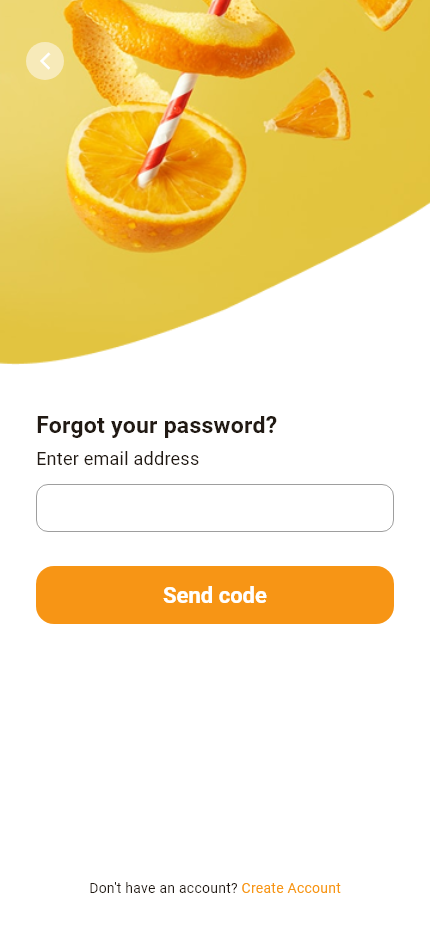
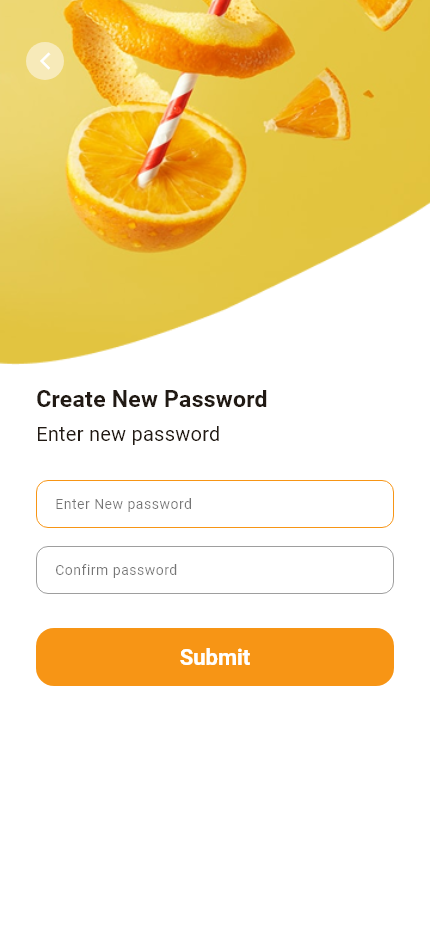

# Orange ส้ม

Orange ส้ม เป็นโปรเจกต์ Flutter และ Dart ที่ถ่ายทอด Mockup สำหรับ iPhone 15 Pro Max ขนาด 430 × 932 logical pixels เป็น UI มือถือ 6 หน้าจอ ตั้งแต่หน้าแนะนำ Berry Juice ถึงหน้าตั้งรหัสผ่านใหม่ แอปใช้ธีม Material 3 และนำทางระหว่างหน้าจอด้วย Flutter Navigator

## ฟังก์ชันการทำงาน

- หน้า Welcome แสดงข้อความ Berry Juice และปุ่ม Explore Now สำหรับไปหน้า Login
- หน้า Login และ Register แสดงฟอร์มกรอกข้อมูล พร้อมลิงก์สลับหน้าจอและไอคอน Google, Facebook และ Apple ตามแบบ UI
- ลิงก์ Forgot Password เปิดลำดับหน้ากรอกอีเมล กรอกรหัส OTP และตั้งรหัสผ่านใหม่ จากนั้นปุ่มยืนยันพากลับไปหน้า Login

## ภาพหน้าจอแอปพลิเคชัน

ภาพจากแอปเวอร์ชันสุดท้ายที่ขนาด 430 × 932 logical pixels

| Welcome / Berry Juice | Login | Register |
| :---: | :---: | :---: |
|  |  |  |

| Forgot Password | OTP Verification | Create New Password |
| :---: | :---: | :---: |
|  |  |  |

## เทคโนโลยีที่ใช้

| เทคโนโลยีหรือแพ็กเกจ | หน้าที่ |
| --- | --- |
| Flutter, Dart และ Material 3 | สร้างหน้าจอ จัดธีม และนำทางระหว่างหน้าจอ |
| `material_ui` | Material widgets สำหรับหน้าจอและฟอร์ม |
| `google_fonts`, `cupertino_icons` | Dependencies ที่ประกาศในโปรเจกต์ |
| `flutter_test`, `flutter_lints` | Widget Test และกฎวิเคราะห์โค้ด |
| `flutter_launcher_icons` | กำหนด Launcher Icon สำหรับ Android และ iOS |

## โครงสร้างโปรเจกต์

| ไฟล์ใน `lib/views/` | Class | หน้าจอ |
|---|---|---|
| `e01_page_ui.dart` | `E01PageUI` | Welcome / Berry Juice |
| `e02_page_ui.dart` | `E02PageUI` | Login |
| `e03_page_ui.dart` | `E03PageUI` | Register |
| `e04_page_ui.dart` | `E04PageUI` | Forgot Password |
| `e05_page_ui.dart` | `E05PageUI` | OTP Verification |
| `e06_page_ui.dart` | `E06PageUI` | Create New Password |

- `lib/main.dart` เริ่มแอป ตั้งธีม และกำหนดความกว้างสูงสุดของ UI ที่ 430 logical pixels
- `lib/views/orange_header.dart` เป็น Widget ส่วนหัวสำหรับหน้าจอกู้คืนรหัสผ่าน
- `assets/images/` เก็บภาพประกอบ ส่วน `assets/icon/icon.png` เป็นต้นทางของ Launcher Icon
- `docs/screenshots/` เก็บภาพหน้าจอ และ `test/` เก็บ Widget Test
- มีโครงสร้างสำหรับ Android, iOS, Web, Windows, Linux และ macOS

## การติดตั้งและใช้งาน

ติดตั้ง Flutter SDK ที่รองรับ Dart ตาม `pubspec.yaml` (`^3.14.0`) และติดตั้ง Chrome จากนั้นเปิด Terminal ที่โฟลเดอร์โปรเจกต์แล้วรัน

```sh
flutter pub get
flutter run -d chrome
```

ใน Chrome DevTools เปิด Device Toolbar แล้วเลือก iPhone 15 Pro Max หรือกำหนด viewport เป็น 430 × 932 เพื่อดู UI ตามขนาดของ Mockup

## การทดสอบและข้อจำกัด

- บันทึกการตรวจ UI เดิมเมื่อ 25 พฤศจิกายน 2569 ใน `.dart_tool/assignment_final/ui-verification.log` ระบุว่าผ่าน 2 รายการ ได้แก่ การตรวจหน้าจอทั้ง 6 และการนำทางที่ 430 × 932 และการตรวจพื้นที่ของฟอร์ม 5 หน้าเมื่อเปิดแป้นพิมพ์ บันทึกชุดนี้ไม่ได้ระบุ Git commit ที่รัน
- มี Widget Test ใน [`test/widget_test.dart`](test/widget_test.dart) สำหรับตรวจข้อความ BERRY JUICE และปุ่ม Explore Now ผลการรันเดิม **NOT VERIFIED**
- ผล `flutter analyze` ผล Build และ Technical Acceptance **NOT VERIFIED**
- ภาพหน้าจอเป็นหลักฐานด้าน UI ที่ขนาด 430 × 932 ผลทดสอบบนอุปกรณ์จริงและผลทดสอบแยกตามแพลตฟอร์ม **NOT VERIFIED**
- ฟอร์มเข้าสู่ระบบ สมัครบัญชี กรอก OTP และตั้งรหัสผ่านใหม่อยู่ในขอบเขตการสาธิต UI แอปยังไม่มี Backend สำหรับยืนยันตัวตน ส่ง OTP หรือบันทึกรหัสผ่าน

## เครดิตและสิทธิ์การใช้งาน

### ทรัพยากรจากอาจารย์และ Figma

การออกแบบ UI และทรัพยากรประกอบแอปพลิเคชันอ้างอิงจาก Figma และ Resources ที่อาจารย์จัดเตรียมให้สำหรับรายวิชาการพัฒนาโปรแกรมประยุกต์สำหรับอุปกรณ์เคลื่อนที่ โดยได้รับอนุญาตจากอาจารย์ให้นำมาใช้ประกอบการส่งงานผ่าน GitHub

### ฟอนต์ แพ็กเกจ และสัญญาอนุญาตโอเพนซอร์ส

UI ใช้ตัวอักษรจากธีม Flutter และไม่พบไฟล์ฟอนต์ที่เก็บเป็น Asset ของโปรเจกต์ ตารางนี้อ้างอิงเวอร์ชันแพ็กเกจจาก `pubspec.lock`

| แพ็กเกจ | ผู้ถือลิขสิทธิ์ | สัญญาอนุญาต |
| --- | --- | --- |
| `material_ui` 1.11.1 | The Flutter Authors | [BSD-3-Clause](https://pub.dev/packages/material_ui/versions/1.11.1/license) |
| `google_fonts` 9.0.0 | The Flutter Authors | [BSD-3-Clause](https://pub.dev/packages/google_fonts/versions/9.0.0/license) |
| `cupertino_icons` 1.0.9 | Vladimir Kharlampidi | [MIT](https://pub.dev/packages/cupertino_icons/versions/1.0.9/license) |
| `flutter_lints` 6.0.0 | The Flutter Authors | [BSD-3-Clause](https://pub.dev/packages/flutter_lints/versions/6.0.0/license) |
| `flutter_launcher_icons` 0.14.4 | Mark O’Sullivan | [MIT](https://pub.dev/packages/flutter_launcher_icons/versions/0.14.4/license) |

### ทรัพยากรและเครื่องหมายการค้าของบุคคลที่สาม

โลโก้ Google, Facebook และ Apple เป็นเครื่องหมายการค้าของเจ้าของแต่ละราย ใช้ประกอบหน้าจอ Login และ Register ตามแบบ UI ในรายวิชา แหล่งต้นฉบับและเงื่อนไขรายไฟล์ของโลโก้ ภาพส้ม และภาพต้นทางของ Launcher Icon ยังยืนยันไม่ได้ โปรเจกต์นี้ยังไม่มีไฟล์ License ระดับ Repository
